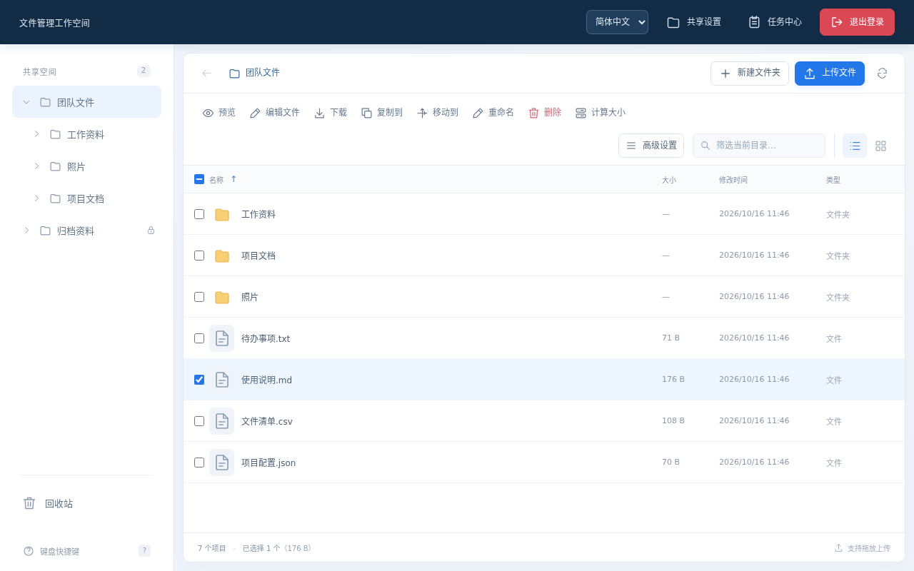

# File Station

**简体中文** | [English](README.en.md)

单管理员 Web 文件管理器，支持普通 Linux 用户、Docker 和 NixOS 部署。React + TypeScript 前端、Go HTTP 服务和 SQLite 持久状态；文件内容直接留在共享目录，宿主机或 Samba 修改文件后刷新即可查看。

应用必须以非 root 用户运行，不提供多用户 Linux 身份映射、提权或系统管理能力。**首次启动默认零共享，不自动共享 home、挂载目录或任何其他路径。** 登录后在「设置 → 共享设置」手动添加目录；容器中需先挂载，再添加容器内路径。

## 界面预览



截图使用演示数据；首次启动仍为空共享，需自行添加目录。

## 主要功能

- 管理员密码登录、12 小时会话和 CSRF 防护；密码默认隐藏，可点击输入框右侧的眼睛按钮切换显示/隐藏。顶部右侧提供独立的「退出登录」按钮，窄屏下也保留图标与文字。
- 登录页及内部页面支持简体中文、英文，可通过语言选择框即时切换，日期、数字和排序随语言调整。首次按浏览器语言选择（中文浏览器使用简体中文，其他语言使用英文），手动选择保存在当前浏览器，刷新及退出登录后保留；浏览器禁止本地存储时仍可切换，但不会保存。语言设置不修改文件名、共享名称或文件内容。
- 多共享目录浏览与管理，支持只读共享、搜索当前目录名称、排序、多选、列表/网格视图；网格仅显示图标和名称，通过全选框旁的「排序」菜单选择字段及递增/递减，文件夹始终排在文件前。列表通过列标题排序，高级设置可保存隐藏项目及列表列显示设置；列表表头与内容使用一致列宽，窄屏下可横向滚动查看其余列。
- 通用设置可选择日期显示格式并预览效果，统一应用于文件修改/创建时间、回收站删除时间和预览窗口；保存后立即生效，并在刷新或重启后保留。
- 通用设置可将文件列表和回收站的权限列切换为八进制（如 `0755`，默认）或符号格式（如 `rwxr-xr-x`），并预览效果；支持特殊权限位的 `s/S/t/T` 显示。保存后立即生效，刷新或重启后保留，仅影响显示，不修改文件实际权限或排序；权限列可在「高级设置 → 列显示」中开启。
- 侧栏从「共享空间」开始，提供共享目录导航、回收站和键盘快捷键入口。
- 新建文件夹、重命名、复制、移动、上传、下载、计算大小；同名冲突可跳过、替换文件或保留两份。
- 回收站、恢复与确认后永久删除；后台任务、上传进度、取消及失败重试。
- PNG/JPEG/GIF/WebP 图片预览：打开时等比适配窗口（小图不放大），支持 Ctrl＋滚轮或按钮缩放、放大后拖动查看，以及一键恢复适应窗口；支持不超过 1 MiB 的 UTF-8 文本预览与编辑。
- MP4/WebM 视频原生播放：支持进度拖动、音量和浏览器全屏，按需读取原文件，不自动播放、不在服务端转码。MP4 建议使用 H.264 + AAC；实际可播放的编码取决于浏览器和操作系统，不支持或损坏的文件仍可下载后查看。
- Markdown 渲染、源码编辑、源码与预览对照、可视化编辑。可视化修改会重新序列化 Markdown，可能规范化空格、列表、表格或不支持的语法；需要逐字保留时使用源码编辑。
- 高级设置内的「关于 File Station」展示软件介绍、当前版本、项目地址与开源许可；点击「检查更新」由服务端连接 GitHub，检查最新正式 Release 并提供发布页链接，不自动下载或安装。尚无 Release、无法比较版本、网络错误或 GitHub 限流会单独提示。

任务中心的复制、移动和回收站失败条目可重试尚未完成的项目，创建新任务并保留原记录；复制和移动可重新选择冲突处理方式。已保存的重试参数在刷新、重启后仍可用，旧版未保存参数的历史任务需重新发起。上传失败可在当前页面内重试，刷新或退出登录后需重新选择文件。

Markdown 可视化编辑器切换语言时会重新初始化工具栏，保留当前正文及未保存状态，但会重置可视化编辑器的撤销历史、光标位置和未提交的插入弹窗；请先完成弹窗操作再切换语言。

## 本地构建与运行

需要 Linux、Go 1.26、Node.js 24 和 npm，也可用 `nix develop path:.`。在仓库根目录使用普通用户：

```sh
npm --prefix web ci
npm --prefix web run build
go build -o /tmp/file-station ./cmd/file-station

mkdir -p "$HOME/.config/file-station" "$HOME/.local/state/file-station"
chmod 700 "$HOME/.config/file-station" "$HOME/.local/state/file-station"
read -rs -p 'Administrator password: ' password
printf '\n'
(umask 077; printf '%s' "$password" > "$HOME/.config/file-station/password")
unset password
```

创建 `$HOME/.config/file-station/config.json`，将 `/absolute/home` 替换成实际绝对路径；JSON 不展开环境变量：

```json
{
  "ip": "127.0.0.1",
  "port": 8080,
  "stateDir": "/absolute/home/.local/state/file-station",
  "passwordFile": "/absolute/home/.config/file-station/password",
  "umask": "0022",
  "secureCookies": false,
  "shares": []
}
```

```sh
chmod 600 "$HOME/.config/file-station/config.json" "$HOME/.config/file-station/password"
/tmp/file-station -config "$HOME/.config/file-station/config.json" -static ./web/dist
```

打开 <http://127.0.0.1:8080>，在「设置 → 共享设置」添加已有目录。也可在 JSON 中用 `password` 直接填写密码，并删除 `passwordFile`；两者必须恰有一个非空来源。

### 更新已有用户服务

若已配置 `file-station.service` 用户服务，且启动程序为 `$HOME/.local/state/file-station/current/bin/file-station`，可运行：

```sh
./test/update-service.sh
```

脚本可从任意工作目录调用，会构建包含前后端的 Nix 包、更新 `current` 链接，再重启用户服务并显示状态；构建失败时不重启。脚本不安装服务、不修改配置、密码或持久状态，也不更新 NixOS 系统服务。若无法读取 `file-station.service` 用户 unit，会提示并在构建、重启前退出；只有旧 `nixos-file-station.service` 时，须先按下文「从旧名称迁移」完成手动迁移，脚本不会接受或重启旧服务。


## 配置文件与环境变量：两种独立来源

本地和 NixOS 推荐使用配置文件，Docker 默认直接通过 `PASSWORD` 填写密码；不自动探测部署环境，也不混合两种业务配置来源：

- **文件模式**：仅通过非空的 `-config /absolute/config.json` 选择 JSON 文件，随后仅使用**内置默认值 + JSON 文件**。Go 配置加载完全忽略 `ConfigPath`、`PASSWORD` 和 `UMASK`，包括空值、非法值；它们既不覆盖文件，也不补齐缺失字段。文件读取失败、JSON 无效、含未知字段或多余 JSON 值时启动失败。
- **环境变量模式**：`-config` 默认为空；未指定或传入 `-config ''` 时，从 `PASSWORD`、`UMASK` 和大小写精确的 `ConfigPath` 获取业务配置。`ConfigPath` 是保存设置的持久状态目录，默认 `/var/lib/file-station`，必须是非空绝对路径，不能是根目录 `/`（包括规范化或成功解析符号链接后指向根目录的路径），显式空值或相对路径无效，绝不是 JSON 文件路径；普通非根绝对路径可以包含空格。固定监听 `0.0.0.0:8080`，首次零共享，`secureCookies` 为 `false`；自定义监听或安全 Cookie 需使用 JSON。

`-config` 不读取任何环境变量来选择配置文件。静态目录**仅由 `-static` 指定**，默认 `web/dist`，必须存在前端构建产物；Nix 包装器和 Docker 镜像命令已指定包内绝对路径，静态目录不属于 JSON 配置。容器入口准备状态目录的规则独立于 Go 配置加载，文件模式也须遵守下文的挂载与权限要求。

| JSON 字段（仅文件模式） | 内置默认值及说明 |
| --- | --- |
| `ip` | `127.0.0.1`；IPv4/IPv6 地址，不带端口或 IPv6 方括号；`0.0.0.0` 监听所有 IPv4 接口 |
| `port` | `8080`；整数 `1–65535` |
| `stateDir` | `/var/lib/file-station`；独立、私有、持久的非空绝对目录，普通用户通常需覆盖此值；文件模式由此字段决定，不读取 `ConfigPath` |
| `password` | 无默认密码，与 `passwordFile` 必须恰有一个非空来源；至少 6 字节，建议至少 12 字节 |
| `passwordFile` | 运行时密码文件绝对路径；读取时去除末尾换行，其他空格保留 |
| `passwordSourceFile` | 默认空；高级部署元数据，额外禁止共享覆盖原始密码源路径，不读取该文件，也不作为认证密码来源 |
| `umask` | `"0022"`；必须是 3 或 4 位八进制字符串，值为 `0000`–`0777`；不能用 JSON 数字或空字符串 |
| `secureCookies` | `false`；HTTPS 部署设为 `true` |
| `shares` | `[]`；可选首次导入，共享设置之后保存在状态数据库 |

Docker 部署仅使用以下五项环境变量，不提供旧名或其他短名别名：

| 环境变量 | 默认值及说明 |
| --- | --- |
| `PUID` | root 入口默认 `1000`；UID 必须为 `1`–`4294967294` 的十进制整数，无前导零，显式空值无效；不是应用配置 |
| `PGID` | root 入口默认 `1000`；GID 格式同上；不是应用配置 |
| `UMASK` | `"0022"`；格式与 JSON `umask` 相同，显式空值无效；文件模式完全忽略 |
| `PASSWORD` | 无默认密码；环境变量模式必填，至少 6 字节，建议至少 12 字节；文件模式完全忽略 |
| `ConfigPath` | `/var/lib/file-station`；保存设置、共享、任务、会话等 SQLite 状态的持久目录，必须为非空绝对路径，不能指向根目录 `/`（包括规范化或成功解析符号链接后为根目录），显式空值或相对路径无效；不是 JSON 文件路径。Go 文件模式忽略它，但容器入口始终按它准备状态目录 |

`passwordSourceFile` 用于 NixOS `LoadCredential` 等将原密码复制到私有凭据路径的部署：`passwordFile` 指向实际读取的凭据，`passwordSourceFile` 仅保护原始绝对路径及可解析的真实路径，避免共享其祖先目录。服务无须有权读取或遍历原始密码文件；无法解析的部分按已知绝对路径和可解析祖先尽力保护，不因此拒绝启动。该隐私元数据在每次启动时生效，不是 `shares` 的一次性导入；调整认证密码来源不会自动清除它。确需移除时，在 JSON 中删除或清空 `passwordSourceFile`。

密码文件和含密码的配置文件应为 `0600`，放在所有共享之外，不提交仓库。Docker 可以直接填写 `PASSWORD`，但明文环境变量及 Compose 配置可被 `docker inspect` 或有权限的宿主管理员读取；不要将密码提交版本库、写入镜像层或 Nix store。需要减少环境变量暴露时可选只读 JSON 文件模式。本地可继续使用 `passwordFile`，NixOS 必须使用运行时密码文件。修改监听、密码、umask 和其他启动配置后需要重启；页面保存共享不需要重启。

顶部齿轮「设置」（英文为 Settings）打开分类首页，点击「通用设置」（General settings）可选择默认格式、`yyyy-MM-dd`、`yyyy/MM/dd`、`dd/MM/yyyy` 或 `MM/dd/yyyy`。默认日期格式随界面语言调整，固定格式不受语言影响；所有格式均按浏览器本地时区、24 小时制显示，保留小时、分钟和秒。选择后点击「保存通用设置」才会生效。点击「共享设置」（Share settings）管理共享目录与访问权限；「返回设置」（Back to settings）回到分类首页，并保留本次弹框内未保存的编辑内容。右上角「关闭」或 Esc 键可关闭设置，重新打开时回到分类首页。保存设置及刷新共享状态期间，不能关闭设置或返回分类首页。顶部语言选择框保持独立，设置页面随所选语言显示。「高级设置」仍在文件工具栏中独立打开。

### 目录权限与持久状态

没有 `allowedRoots` 人工白名单，也没有固定的 `/etc`、`/nix` 路径黑名单。目录选择器从 `/` 浏览，列出进程能读取和遍历的目录；是否能添加、读写共享取决于**服务进程实际 UID、主组/附加组、Unix 权限、ACL 和挂载选项**。每一级父目录都需遍历权限，列目录需读权限，写操作还需相应的写权限。应用不会以登录浏览器用户的身份执行文件操作，也不会自动 `chown` 共享数据。

共享必须是已经存在、可访问且互不重叠的目录；共享根路径会规范化并解析宿主符号链接，进入共享后的文件操作仍禁止跟随符号链接。`readOnly` 是额外的应用级限制，不能授予操作系统原本没有的权限；若需操作系统级只读保护，用只读挂载或 ACL。目录选择器可以浏览 `/`，不代表可以共享 `/`：任何覆盖私有状态或密码文件的宽泛祖先目录都不能添加为共享。

持久状态目录由环境变量模式的 `ConfigPath` 或文件模式的 JSON `stateDir` 指定，权限为 `0700`，必须属于运行 UID，与共享互不重叠，不能放在临时目录或随部署删除。目录中的 `state.sqlite` 保存设置、共享、任务、会话和回收站元数据；它不是启动 JSON。将整个 home 设为共享可能因其中包含状态/密码而被拒绝，应选择具体数据子目录。配置文件若含内联密码，也必须由管理员放在共享之外。

### 首次导入与共享管理

`shares` 仅在状态数据库首次初始化时导入一次，即使最初为空也会记录初始化；以后修改 JSON、重启或回滚 NixOS generation 都不会覆盖已保存共享。环境变量模式不提供首次导入项。可选 JSON 导入格式如下，通常无需配置：

```json
[{"id":"documents","name":"文档","path":"/srv/documents","readOnly":false}]
```

每项必需 `name`、`path`，`id` 可省略自动生成，`readOnly` 默认 `false`。保留已有状态数据库和共享 ID，避免破坏任务与回收站关联。

后续在「设置 → 共享设置」新增、编辑和移除，保存立即生效；移除只删除配置，不删除目录内容。任何文件请求（含上传、下载）处理中，共享变更暂时返回 HTTP 409；受影响共享有活动后台任务时也不可修改或移除。回收站非空时不能变更路径或移除，需先恢复或永久删除。目录丢失、挂载未就绪或权限不足时，已保存共享保留并标为不可用，不自动删除或迁移。

## Docker / Compose

镜像使用 Node.js 24 和 Go 1.26 多阶段构建，最终包含 Alpine、CA 证书、`su-exec`、静态 Go 程序和前端，运行时不需要 Node.js 或 Go。入口脚本短暂以 root 校验 `PUID` / `PGID`（未设置时默认 `1000:1000`），按 `ConfigPath`（默认 `/var/lib/file-station`）准备私有状态目录，只调整目录本身的属主，随后通过 `su-exec` 降权；Go 服务再以该非 root 身份将实际使用的状态目录权限设为 `0700`。**应用进程始终以非 root 身份运行**，不递归更改已有状态内容，更不更改共享数据。直接传入 `docker run -e PUID=… -e PGID=…` 即可选择身份，无需 Compose `user:`。入口要求 `ConfigPath` 非空、为绝对路径且目录本身不是符号链接，也拒绝解析后为根目录 `/` 的路径。

仓库 `compose.yaml` 默认仅发布到宿主 `127.0.0.1:8080`，将 `./state` 挂载到 `${ConfigPath-/var/lib/file-station}` 持久化，挂载目标与传入容器的 `ConfigPath` 同步，不再使用 Compose secret。其环境变量只有以下五项；`PASSWORD` 没有默认密码，文件模式允许它为空，环境变量模式则会在启动时检查至少 6 字节：

```yaml
environment:
  PUID: '${PUID-1000}'
  PGID: '${PGID-1000}'
  UMASK: '${UMASK-0022}'
  PASSWORD: '${PASSWORD-}'
  ConfigPath: '${ConfigPath-/var/lib/file-station}'
```

在仓库根目录的 Bash 中为**全新部署**准备：

```sh
# 使用当前普通用户；也可改为指定的非 root UID/GID。
export PUID="$(id -u)" PGID="$(id -g)" UMASK='0022' ConfigPath='/var/lib/file-station'
read -rs -p 'Administrator password (at least 6 bytes; 12+ recommended): ' PASSWORD
printf '\n'
export PASSWORD
mkdir -p state
docker compose up -d --build
unset PASSWORD
```

若希望直接填写密码，可创建不提交仓库的私有 `.env`（权限 `0600`），然后运行 `docker compose up -d --build`：

```dotenv
PUID=1000
PGID=1000
UMASK='0022'
PASSWORD='请替换为你自己的至少12字节密码'
ConfigPath='/var/lib/file-station'
```

`PASSWORD` 没有默认值，上例必须替换。**Compose YAML 中直接填写的密码包含 `$` 时需写成 `$$`；在 `.env` 中则用单引号包住密码，避免变量插值。** 不要只依赖 YAML 单引号阻止 Compose 插值，也不要使用文档示例密码作为实际密码。

推荐的自定义状态路径示例是 `ConfigPath=/config`：在私有 `.env` 中设置 `ConfigPath='/config'`，Compose 会同步把 `./state` 挂载到 `/config`（即 `./state:/config`），SQLite 等持久状态直接保存在该目录。不要填写 `/config/config.json`，也不要设置 `ConfigPath=''`。

入口只准备状态目录本身。**已有数据更换 UID/GID 时，管理员必须先停服务、备份，再安全迁移私有状态目录及其已有内容的属主，保留权限和内容**，不能依赖入口递归修复。状态仍必须持久化，删除或替换状态库会丢失共享设置、任务、会话和回收站关联。rootless Docker / user namespace remapping 需按其宿主 UID 映射准备权限。

Compose 默认不设置 `user:`；保留 `cap_drop: [ALL]`，仅为入口准备目录和降权添加 `CHOWN`、`SETUID`、`SETGID`，并保留 `no-new-privileges:true`。若显式使用非 root `--user UID:GID`，未设置的 `PUID` / `PGID` 沿用当前身份，不套用 root 入口的默认值；入口不会提权或更改目录属主，状态目录须提前归属当前身份，Go 服务仍会设置其权限为 `0700`。显式设置的 `PUID` / `PGID` 与当前身份不符会报错。

Compose 中默认**没有数据共享挂载**。例如取消以下注释并按需修改：

```yaml
volumes:
  - './state:${ConfigPath-/var/lib/file-station}'
  - /srv/documents:/mnt/documents
  # - /srv/archive:/mnt/archive:ro
```

重建容器后在 UI 手动添加 **`/mnt/documents`**，不是宿主 `/srv/documents`。挂载不等于自动共享，容器也不能浏览没有挂载进来的宿主路径。宿主目录的 UID/GID、ACL 和只读挂载仍生效。`su-exec` 切换身份会清空附加组，不要依赖 Docker `group_add` / `--group-add` 保留权限；请按进程实际身份设置主组权限或 ACL。不要为图方便改成 root，也不要递归修改现有共享数据的属主。

也可不用 Compose（先准备 `state`，以下命令从终端读取密码，不读取 Compose 的 `.env`）：

```sh
mkdir -p state
read -rs -p 'Administrator password (at least 6 bytes; 12+ recommended): ' PASSWORD
printf '\n'
export PASSWORD
docker build -t file-station:local .
docker run -d --name file-station \
  --cap-drop ALL \
  --cap-add CHOWN --cap-add SETUID --cap-add SETGID \
  --security-opt no-new-privileges:true \
  -p 127.0.0.1:8080:8080 \
  -e PUID="${PUID-1000}" -e PGID="${PGID-1000}" \
  -e UMASK='0022' -e PASSWORD -e ConfigPath=/var/lib/file-station \
  --mount "type=bind,src=$PWD/state,dst=/var/lib/file-station" \
  file-station:local
unset PASSWORD
```

镜像命令为 `-static /usr/share/file-station`。环境变量模式固定监听容器内 `0.0.0.0:8080`，状态目录由 `ConfigPath` 决定（默认 `/var/lib/file-station`），首次零共享；宿主映射仍仅为 `127.0.0.1:8080`。直接 `docker run` 若改用 `-e ConfigPath=/config`，也须同步把上面的状态挂载改为 `-v "$PWD/state:/config"`。公开监听时应显式调整端口映射及防火墙。Compose 只透传上面列出的五项，并不会自动透传宿主 shell 或 `.env` 的其他变量。

### Docker 的可选 JSON 文件模式

需要自定义监听、安全 Cookie 或使用密码文件时，可只读挂载 JSON 并显式传入 `-config`；仅自定义持久状态目录不必切换模式，使用 `ConfigPath` 即可。例如创建私有 `config.json`（`0600`，不在共享内），直接在其中填写实际密码：

```json
{
  "ip": "0.0.0.0",
  "port": 8080,
  "stateDir": "/var/lib/file-station",
  "password": "replace-with-your-own-long-password",
  "umask": "0022",
  "secureCookies": false,
  "shares": []
}
```

确保运行 UID 可以读取该文件，然后在 Compose 中启用可选配置挂载并设置完整命令（覆盖镜像 CMD 后必须保留 `-static`）：

```yaml
environment:
  PUID: '${PUID-1000}'
  PGID: '${PGID-1000}'
  UMASK: '${UMASK-0022}'
  PASSWORD: '${PASSWORD-}'
  ConfigPath: '${ConfigPath-/var/lib/file-station}'
volumes:
  - './state:${ConfigPath-/var/lib/file-station}'
  - ./config.json:/etc/file-station/config.json:ro
command: ["-config", "/etc/file-station/config.json", "-static", "/usr/share/file-station"]
```

此 JSON 使用默认状态目录，因此应保持 `ConfigPath=/var/lib/file-station`（或不设置它）。若改为推荐的 `ConfigPath=/config`，须同时将 JSON 的 `stateDir` 改为 `/config`，Compose 会同步挂载 `./state:/config`。

直接 `docker run` 时，在前面的完整命令中于镜像名之前追加 `--mount "type=bind,src=$PWD/config.json,dst=/etc/file-station/config.json,readonly"`，并将最后的镜像命令改为：

```sh
  file-station:local -config /etc/file-station/config.json -static /usr/share/file-station
```

也可在 JSON 中使用 `passwordFile` 代替 `password`，再只读挂载对应密码文件；文件需对运行 UID 可读，且位于共享之外。

选择文件模式后，**Go 配置加载完全忽略 `ConfigPath`、`PASSWORD` 与 `UMASK`，无论是否为空或有效**，不能作为 JSON 的回退；`PUID` / `PGID` 仍用于容器身份。但容器入口仍会校验 `ConfigPath` 并准备其指定的运行时状态目录，不读取 JSON 或根据 `-config` 改变准备路径。通常应让 JSON `stateDir`、`ConfigPath` 和持久挂载目标保持一致；若有意使用不同路径，管理员必须自行持久挂载并预备 JSON `stateDir` 的目录及权限，入口不会替它准备。JSON 必须使用容器内路径；容器文件模式须明确设置 `ip: "0.0.0.0"`，否则 JSON 默认 `127.0.0.1` 会导致端口映射无法访问服务。HTTPS 部署在 JSON 中设置 `secureCookies: true`；静态目录仍由显式 `-static` 参数独立指定。

## Nix 包与 NixOS 服务

```sh
nix build path:.#file-station
./result/bin/file-station -config "$HOME/.config/file-station/config.json"
```

`default` 与 `file-station` 包相同，flake 支持 `x86_64-linux` 和 `aarch64-linux`。包内包装器自动指定前端，无需 `-static`。源码 input 和主页继续使用实际仓库地址 `github:CYL96/NixOS-File-Station`。

NixOS 模块生成 JSON 并通过 `-config` 启动，因此始终使用文件模式；监听、状态、密码、隐私元数据和首次导入共享由模块配置产生，不受 `ConfigPath` / `PASSWORD` / `UMASK` 覆盖。模块固定生成 `umask: "0077"` 并保留 systemd `UMask=0077`，不提供额外 umask 选项。

在系统 flake 添加 input 并导入模块，已有 flake 合并对应部分即可：

```nix
{
  inputs = {
    nixpkgs.url = "github:NixOS/nixpkgs/nixos-unstable";
    file-station.url = "github:CYL96/NixOS-File-Station";
    file-station.inputs.nixpkgs.follows = "nixpkgs";
  };

  outputs = inputs@{ nixpkgs, ... }: {
    nixosConfigurations.myhost = nixpkgs.lib.nixosSystem {
      system = "x86_64-linux";
      modules = [
        ./configuration.nix
        inputs.file-station.nixosModules.default
        {
          users.groups.documents = {};
          # 仅预建新的专用数据目录，不递归改动已有文件。
          systemd.tmpfiles.rules = [ "d /srv/documents 2770 root documents - -" ];
          services.file-station = {
            enable = true;
            ip = "127.0.0.1";
            port = 8080;
            passwordFile = "/run/secrets/file-station-password";
            stateDir = "/var/lib/file-station";
            user = "file-station";
            group = "file-station";
            supplementaryGroups = [ "documents" ];
            # shares 默认 {}，首次登录后手动添加 /srv/documents。
          };
        }
      ];
    };
  };
}
```

默认自动创建专用系统用户和组 `file-station`，不再依赖名为 `nixos` 的登录用户。`user` 可改为已有非 root 用户，该用户须在 `users.users` 声明；模块不会修改自定义账户的主组或登录配置。`group` 可自定义，模块会创建该组，已有组定义可正常合并。`SupplementaryGroups` 仅为服务进程追加权限，不更改账户的全局组成员关系。例如：

```nix
services.file-station = {
  user = "alice";       # users.users.alice 已在系统配置中声明
  group = "file-data";  # 模块创建此组，也可与已有定义合并
  supplementaryGroups = [ "documents" ];
};
```

复用已有用户会与其其他进程共享 UID，失去专用用户的隔离边界。授权已有数据时优先按需设置组权限或 ACL，所有父目录也需可遍历。模块不创建默认共享或 home，不递归更改共享目录；状态目录以 `0700` 创建，私有状态内容属主/组调整为所选用户/组，保留已有状态文件权限。

部署前用秘密管理工具或管理员操作提供 `passwordFile`；可以保持 root:root、`0600`，父目录也可仅 root 访问。systemd `LoadCredential` 将其传入服务私有凭据路径；生成的 JSON 中 `passwordFile` 指向该凭据，`passwordSourceFile` 记录原始路径，防止 UI 共享覆盖密码源的目录。原始路径只是防共享元数据，应用不读取它，也不将其用于认证；密码内容不会写入生成的 JSON 或 Nix store。**必须使用运行时绝对路径字符串，不能用 Nix 路径字面量、`writeText` 或其他产出 store 文件的方式保存密码。**

模块移除了依赖目录白名单的 `ReadWritePaths`/`ReadOnlyPaths`，以及 `ProtectSystem`、`ProtectHome`、`PrivateTmp`、`PrivateDevices` 文件系统重映射；不再另设一套共享路径权限。`RemoveIPC=false` 避免服务停止时清理同一用户或组的其他进程所用 IPC 对象，即使使用默认用户但自定义共享组也保持此设置。保留禁止提权、空 capability 集、内核/控制组保护等加固，敏感内核接口仍受保护。普通数据路径由服务用户实际权限决定。UI 添加的共享不会自动生成挂载依赖；网络磁盘等应在系统中配置挂载和服务启动顺序，例如通过 `systemd.services.file-station.unitConfig.RequiresMountsFor = [ "/mnt/documents" ];`。

可选 Nix 首次导入写法为 `shares.documents = { name = "文档"; path = "/srv/documents"; readOnly = false; };`；属性名是稳定共享 ID，仍遵守仅首次初始化导入规则。

```sh
sudo nixos-rebuild switch --flake /path/to/system-flake#myhost
systemctl status file-station
journalctl -u file-station
sudo systemctl restart file-station
```

## 从旧名称迁移（破坏性变更）

旧 `nixos-file-station` 二进制、flake 包属性、`services.nixos-file-station` 选项和 `nixos-file-station.service` 已删除，统一改为 `file-station` / `services.file-station` / `file-station.service`，没有兼容别名。`allowedRoots` 已删除，应从 JSON/Nix 配置中移除，改用服务账户权限、ACL 和挂载选项授权。

旧 `FILE_STATION_*` 环境变量已全部删除，不提供兼容别名。Docker 改用 `PUID`、`PGID`、`UMASK`、`PASSWORD`、`ConfigPath`；默认直接填写密码，旧 Compose secret 挂载应移除或迁移为显式 `-config` 选择的 JSON 文件模式。`ConfigPath` 仅表示持久状态目录，不再用来选择启动 JSON；默认 `/var/lib/file-station`，不能留空。静态目录仅使用 `-static`，自定义监听和安全 Cookie 等设置迁入 JSON。

**普通新建内容的默认权限有所放宽**：本地/JSON 默认 `umask: "0022"` 产生 `0644` 文件、`0755` 目录，不再是此前的 `0640` / `0750`。如需保持此前本地权限，在 JSON 中明确设置 `"umask": "0027"`；Docker 环境变量模式可设置 `UMASK='0027'`。已有内容权限不自动改动，NixOS 仍固定使用 `"0077"`。

默认状态路径从 `/var/lib/nixos-file-station` 改成 `/var/lib/file-station`。**迁移时停旧服务并备份，显式设置 `services.file-station.stateDir = "/var/lib/nixos-file-station";`（本地文件模式在 JSON 中设置 `stateDir`；Docker 环境变量模式设置 `ConfigPath`，文件模式同时匹配 `ConfigPath` 与 JSON `stateDir`，并将持久挂载目标指向该目录），保留原 SQLite 和所有状态文件。** 也可在停服务后完整迁移状态到新路径并正确设置运行 UID/GID 的属主，不能通过删除状态库重置。Nix 模块会把所选状态路径归属调整到新服务用户/组；Docker 入口只调整状态目录本身，已有内容由管理员安全迁移。不要同时运行新旧服务访问同一状态库。旧 bootstrap `shares` 不会覆盖数据库，已有共享继续保留，权限变化时可在 UI 修正。

会话 Cookie 从 `nixos_file_station_session` 改为 `file_station_session`，旧浏览器会话不兼容，需要重新登录。旧 unit 的自定义覆盖、监控和日志命令也应迁移；仓库远程 URL 没有变更。

### 手动迁移旧用户服务

以下仅针对 `systemctl --user` 管理的旧 `nixos-file-station.service`，不是 NixOS 系统服务迁移命令。全程使用原普通用户；先查看旧 unit 的 `ExecStart`、环境和 drop-in，以及其实际配置文件，确认原 `stateDir`、密码来源和必要的启动选项。不要因为改名而套用新的默认状态目录，也不要重新生成密码。

1. **先构建新包，成功后再停旧服务**。在仓库根目录执行，生成后续 unit 使用的可执行文件；构建失败则保留旧服务运行，不继续迁移：

   ```sh
   systemctl --user cat nixos-file-station.service
   mkdir -p "$HOME/.local/state/file-station"
   nix build path:.#default --out-link "$HOME/.local/state/file-station/current"
   ```

2. 将下面三个变量替换成**实际绝对路径**，停旧服务后备份完整状态、配置和旧 unit。备份目录必须在状态目录和所有共享之外；若共享包含整个家目录，不能把备份放在家目录。以下命令在同一个 shell 中依次执行：

   ```sh
   config_path='/absolute/path/to/existing-config.json'
   state_dir='/absolute/path/to/existing-state'
   backup_dir='/absolute/private/path/outside-shares/migration-backup'
   umask 077
   systemctl --user stop nixos-file-station.service
   mkdir -p "$backup_dir"
   systemctl --user cat nixos-file-station.service > "$backup_dir/nixos-file-station.service.txt"
   cp -a -- "$config_path" "$backup_dir/config.json"
   cp -a -- "$state_dir" "$backup_dir/state"
   ```

   若密码来自独立文件，还须将实际密码源文件私密备份到 `"$backup_dir/password"`，保留其原文件和权限；若 unit 通过凭据或环境提供密码，也须备份对应源文件和设置。unit 快照包含 drop-in 内容，私密保存；自定义 drop-in 的源文件也应一并备份。停止期间不要运行其他使用该状态目录的实例；备份失败不要启动新服务。

3. 编辑 `"$config_path"`：删除已不支持的 `allowedRoots`，**显式保留原 `stateDir` 绝对路径**、现有密码来源以及监听等必要设置。JSON 中的 `password` / `passwordFile` 必须恰有一个非空；选用 JSON 后会忽略 `PASSWORD`，旧 `FILE_STATION_*` 也不再生效。若旧密码只在环境中，须安全迁入 JSON 的 `password` 或私有文件的 `passwordFile`，保持密码内容不变；若使用 systemd 凭据，须在新 unit 保留相应 `LoadCredential`，并让 JSON 的 `passwordFile` 指向实际凭据路径。保留需要的 `passwordSourceFile` 隐私保护元数据。不要删除 SQLite、其他状态文件或重置共享；已有共享从原数据库读取。

4. 创建新的用户 unit。下面模板将 `-config` 写成上述 `config_path` 的实际路径，而不是假定配置已搬到新目录。按旧 unit 补回必要的凭据、挂载依赖和自定义设置，不要保留旧二进制名或旧启动路径：

   ```sh
   mkdir -p "$HOME/.config/systemd/user"
   cat > "$HOME/.config/systemd/user/file-station.service" <<EOF
   [Unit]
   Description=File Station

   [Service]
   ExecStart=%h/.local/state/file-station/current/bin/file-station -config "$config_path"
   Restart=on-failure

   [Install]
   WantedBy=default.target
   EOF
   ```

   若已有 `file-station.service` 或其 drop-in，先备份并合并审阅，不要直接覆盖。Nix 包已指定静态资源路径，无须沿用旧 `-static` 路径。

5. 禁用旧 unit 后再加载并启用新 unit；**禁止新旧服务并发访问同一状态目录**：

   ```sh
   systemctl --user disable nixos-file-station.service
   systemctl --user daemon-reload
   systemctl --user enable --now file-station.service
   systemctl --user status file-station.service --no-pager
   ```

   登录确认原共享和设置保留；需要排错时查看 `journalctl --user -u file-station.service`，不要通过删除状态重新初始化。迁移完成后，后续更新仍使用 `./test/update-service.sh`。

## HTTPS、反向代理与防火墙

局域网部署推荐 HTTPS 代理，并在 JSON 设置 `secureCookies: true`，NixOS 对应 `services.file-station.secureCookies = true`；Docker 需要切换到 JSON 文件模式设置，环境变量模式不提供该选项。普通 HTTP 不应启用 Secure，否则浏览器不会发送会话 Cookie。

- 代理保留原始 Host，前端和接口同源，不要拆分不同域名/端口。
- 后台事件使用 SSE，关闭 `/api/events` 代理缓冲并配置足够长的连接超时。
- 按需设置上传大小限制。
- NixOS 模块不会自动开放防火墙。使用代理时开放 HTTPS 端口；直接监听局域网时按需开放服务 TCP 端口并限制可信访问范围。

## 文件操作限制与备份安全

- 应用权限检查不能替代操作系统隔离。只授予服务账户必要权限；挂载点和已有硬链接可能暴露其他数据。不能删除共享根目录或操作共享之外、不可用共享中的文件；`.webui-*` 内部路径不允许通过普通文件接口访问。
- 共享内部的符号链接可显示，但不能进入、下载、预览或复制；移动、重命名、回收站处理链接本身。只操作普通文件和目录，不处理特殊文件。
- 复制不保留 Unix 所有者、ACL、扩展属性、硬链接关系或原始时间。同名目录不能递归覆盖。普通新文件权限为 `0666 & ~umask`、新目录为 `0777 & ~umask`，仍受 ACL 等操作系统权限规则影响；默认 `"0022"` 对应 `0644` / `0755`，`"0077"` 对应 `0600` / `0700`。该设置只作用于普通新建、上传和复制产生的文件/目录；内部状态与暂存保持私有，文本保存、同文件系统移动以及回收站恢复不更改原内容权限。NixOS 固定应用 `umask: "0077"` 并保留 `UMask=0077`。
- 上传和复制使用目标目录隐藏临时文件，不静默覆盖。取消不回滚已完成条目；异常中断后可能残留临时文件，确认无任务后再由管理员清理。
- 文本编辑限已有、不含 NUL、不超过 1 MiB 的 UTF-8 普通文件。只读共享、回收站、符号链接、无写权限或多硬链接文件不能保存。保存需保留权限、属主/组、ACL 和扩展属性，无法完整保留则拒绝；原子替换改变 inode 和原始时间。
- 文本保存检查读取版本，外部修改时保留草稿并报告冲突，不提供强制覆盖。但检查与替换之间仍可能有外部写入，**不是文件系统级 CAS**。统一 CRLF 的文件保留 CRLF，其他换行编辑后统一为 LF。
- 同文件系统移动为原子重命名；跨文件系统先复制后删除，**不是整体事务**，失败后源和目标可能同时存在。
- 后台任务完成/失败状态持久化；重启时未完成任务标为中断，不自动重放。
- 回收站在共享根下 `.webui-trash`，占用同一文件系统空间，元数据在 `stateDir`。**回收站不是备份**；停止服务及其他写入后，一致地备份共享文件、隐藏回收站和状态数据库。
- 文本不作为网页执行；Markdown 预览不执行原始 HTML，外部图片不自动加载。会话 Cookie 使用 HttpOnly、SameSite=Strict，HTTPS 应启用 Secure。
- **NixOS generation 回滚不会回滚文件删除、覆盖或数据库变更。**
